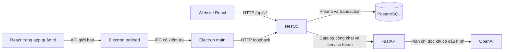

# Học mã nguồn VNWatch

Bắt đầu ở đây, sau đó mở file nguồn và tìm `HỌC VNWATCH`. Chú thích tiếng Việt được đặt ở đầu file, trước hàm/lớp, cạnh trường dữ liệu và các bước nghiệp vụ quan trọng. Không cần đọc từ dòng đầu đến dòng cuối của cả dự án trong một buổi.

Mã nguồn hiện tại nằm trong **D:\VNWatch\outputs**. Mở **D:\VNWatch** bằng VS Code để các liên kết và chức năng tìm định nghĩa hoạt động. Bật `View → Word Wrap` để đọc chú thích dài; dùng `Ctrl+P` tìm file, `Ctrl+Shift+F` tìm tên hàm và `F12` đi tới định nghĩa. Trong terminal, xem đường dẫn hiện tại trước khi chạy lệnh vì mỗi phần có package riêng.

## 1. Bản đồ dự án

| Thư mục/file | Trách nhiệm | Điểm đọc đầu tiên |
| --- | --- | --- |
| `outputs/vnwatch-frontend` | Website React/TypeScript cho khách hàng, và các component giao diện quản trị dùng chung | [main.tsx](outputs/vnwatch-frontend/src/main.tsx), [App.tsx](outputs/vnwatch-frontend/src/App.tsx) |
| `outputs/vnwatch-backend` | NestJS: HTTP, phân quyền, nghiệp vụ và truy cập PostgreSQL | [main.ts](outputs/vnwatch-backend/src/main.ts), [app.module.ts](outputs/vnwatch-backend/src/app.module.ts) |
| `outputs/vnwatch-agent` | FastAPI: trợ lý chỉ đọc catalog/chính sách, tùy cấu hình có OpenAI | [main.py](outputs/vnwatch-agent/main.py), [consultant.py](outputs/vnwatch-agent/consultant.py) |
| `outputs/vnwatch-manager` | Electron: app Windows cài sẵn và cầu nối API giới hạn | [main.ts](outputs/vnwatch-manager/src/main.ts), [preload.ts](outputs/vnwatch-manager/src/preload.ts) |
| `compose.yaml`, `docker` | Đóng gói, khởi động, chuyển dữ liệu và kiểm chứng dịch vụ | [compose.yaml](compose.yaml), [DOCKER.vi.md](DOCKER.vi.md) |
| `prisma/schema.prisma` | Mô hình dữ liệu nguồn, quan hệ và index | [schema.prisma](outputs/vnwatch-backend/prisma/schema.prisma) |
| `test`, `tests` | Kịch bản tự động kiểm chứng API, React, Electron và trợ lý | [Chỉ mục file](docs/learning/FILE-INDEX.vi.md) |

[Chỉ mục file và vai trò](docs/learning/FILE-INDEX.vi.md) có liên kết tới từng file đã được chú thích. `Management.tsx`, `Orders.tsx` và `Shopping.tsx` dài vì chứa nhiều component; đọc theo tên hàm, không theo số dòng cố định.



Website và phần mềm quản trị dùng cùng backend/database. Giao diện quản trị được đóng gói trong app Windows; `main.ts` của NestJS và `main.ts` của Electron là hai điểm chạy khác nhau, cần nhìn đường dẫn đầy đủ.

## 2. Cách đọc chú thích

- `//` là chú thích một dòng trong TypeScript/Prisma; `/* ... */` hoặc `/** ... */` là chú thích khối.
- `#` là chú thích trong Python, PowerShell, YAML, Dockerfile và các file cấu hình phù hợp.
- `<!-- ... -->` là chú thích HTML. Trong JSX, chú thích bên trong cây giao diện cần viết `{/* ... */}`.
- `rem` là chú thích của file `.cmd`; `--` là chú thích SQL trong bản migration học tập.

Các chú thích tập trung vào đầu vào, kết quả, state và lý do kiểm tra/khóa dữ liệu. Dấu `}` chỉ đóng khối; dòng import không cần giải thích lặp lại từng tên khi chức năng của dependency đã rõ ở nơi sử dụng.

Các file JSON không nhận comment tiêu chuẩn. Vì vậy `package.json`, `tsconfig.json` và lockfile giữ định dạng nguyên bản; phần 12 giải thích những khóa cần học. `node_modules`, `.venv`, Prisma `src/generated`, `dist`, app đã đóng gói và thư viện `vendor` là dependency/output: đọc nguồn gốc tương ứng trước. Chú thích thêm vào file sinh tự động sẽ mất khi công cụ sinh lại.

Migration gốc đã áp dụng được giữ nguyên để bảo toàn checksum. Đọc **[bản SQL có chú thích](docs/learning/MIGRATIONS.vi.md)** trong `docs/learning/migrations`; không chạy bản học tập bằng Prisma.

## 3. Nền tảng TypeScript trước khi đọc nghiệp vụ

| Cú pháp | Ý nghĩa trong dự án |
| --- | --- |
| `const`, `let` | `const` không gán lại biến; object bên trong vẫn có thể thay thuộc tính. `let` cho phép gán lại. |
| `import`, `export` | Kết nối các file; `import type` chỉ dùng lúc kiểm tra kiểu. |
| `interface`, `type` | Mô tả cấu trúc/kiểu, không tự kiểm tra JSON nhận từ mạng. |
| `class`, `constructor` | Gom dữ liệu và phương thức; NestJS cấp dependency thông qua constructor. |
| `private readonly prisma` | Tạo thuộc tính trong lớp, giới hạn truy cập và không gán lại thuộc tính; không có nghĩa database là chỉ đọc. |
| `async`, `await`, `Promise<T>` | Hàm trả kết quả sau một tác vụ bất đồng bộ. `await` chờ tác vụ; không tự tạo transaction. |
| `<T>` trong `api<T>` | Generic cho biết dạng kết quả TypeScript; server vẫn phải validation dữ liệu đầu vào. |
| `?`, `?.`, `??` | Lần lượt: trường tùy chọn; truy cập an toàn khi null/undefined; dùng mặc định khi null/undefined. |
| `!` sau tên | Báo TypeScript rằng giá trị sẽ tồn tại; không kiểm tra hay bổ sung giá trị lúc chạy. |
| `...` | Copy/gộp thuộc tính hoặc phần tử. Thứ tự gộp quyết định giá trị nào ghi đè. |
| `map`, `filter`, `reduce` | Ánh xạ, chọn dòng và tính tổng. Kiểm tra callback trả gì và có đổi dữ liệu gốc không. |
| `try/catch/finally` | Chạy tác vụ, xử lý lỗi, luôn dọn busy/slot/kết nối khi đi qua finally. |

Thực hành bằng [api.ts](outputs/vnwatch-frontend/src/api.ts): `api<Product>(...)` cho TypeScript biết kết quả kỳ vọng là `Product`; nó không biến JSON sai thành đúng. Xem [assistant.service.ts](outputs/vnwatch-backend/src/assistant/assistant.service.ts) để thấy việc kiểm tra lại JSON agent sau một phép cast kiểu.

## 4. Bài đầu tiên: từ danh sách đồng hồ tới database

Đọc theo thứ tự:

1. [App.tsx](outputs/vnwatch-frontend/src/App.tsx): state bộ lọc và effect gọi `/products`.
2. [api.ts](outputs/vnwatch-frontend/src/api.ts): tiền tố `/api/v1`, timeout và đọc JSON.
3. [catalog.controller.ts](outputs/vnwatch-backend/src/catalog/catalog.controller.ts): `@Get`, `@Query`, `@Param`.
4. [list-products.dto.ts](outputs/vnwatch-backend/src/catalog/dto/list-products.dto.ts): chuyển query chuỗi và kiểm tra giới hạn.
5. [catalog.service.ts](outputs/vnwatch-backend/src/catalog/catalog.service.ts): kiểm tra khoảng giá và ánh xạ public DTO.
6. [catalog.repository.ts](outputs/vnwatch-backend/src/catalog/catalog.repository.ts): điều kiện SQL/Prisma và phân trang.
7. [schema.prisma](outputs/vnwatch-backend/prisma/schema.prisma): `Product`, `ProductVariant` và index.
8. [catalog.integration.test.ts](outputs/vnwatch-backend/test/catalog.integration.test.ts): điều kiện nào được kiểm chứng.

Một mẫu là thiết kế chung, còn SKU là phiên bản có giá/tồn riêng. `variants: { some: variants }` nghĩa là có ít nhất một SKU thỏa **đồng thời** các bộ lọc. Không lấy giá của SKU A rồi tồn của SKU B để nói mẫu phù hợp.

`skip = (page - 1) * limit` bỏ qua các dòng trước trang, `take = limit` giới hạn số dòng. `count` tạo tổng kết quả. Đọc `RepeatableRead` để hiểu vì sao count và trang cần thấy cùng snapshot khi dữ liệu đang đổi.

Catalog sản phẩm thật nằm ở [reference-data.ts](outputs/vnwatch-backend/src/database/reference-data.ts). Ngày nguồn được kiểm tra là dữ liệu lưu sẵn, không có nghĩa website tự crawl giá mỗi ngày. `upsert` với `update: {}` chỉ thêm bản ghi thiếu, không ghi đè giá/tồn admin đã sửa.

**Tự kiểm tra:** Với một mẫu có SKU 1,5 triệu và 3,2 triệu, khi lọc 2–3 triệu thì mẫu có phù hợp không? Tìm điều kiện `priceVnd` để giải thích.

## 5. Đăng nhập, phiên và quyền ADMIN

Đọc [Account.tsx](outputs/vnwatch-frontend/src/Account.tsx) → [auth.controller.ts](outputs/vnwatch-backend/src/auth/auth.controller.ts) → [auth.dto.ts](outputs/vnwatch-backend/src/auth/auth.dto.ts) → [auth.service.ts](outputs/vnwatch-backend/src/auth/auth.service.ts).

Trong `auth.module.ts`, `APP_GUARD` gắn SessionGuard/AuthRateGuard vào toàn ứng dụng. `@Public()` bỏ yêu cầu phiên cho route công khai. `@Roles('ADMIN')` hạn chế route theo vai trò; ẩn nút trên React chỉ là giao diện, không thay thế kiểm tra server.

Mật khẩu dùng scrypt với salt riêng trong [password.service.ts](outputs/vnwatch-backend/src/auth/password.service.ts). Token đăng nhập là chuỗi ngẫu nhiên opaque; database giữ SHA-256 của token trong `UserSession`. Client gửi token gốc qua `Authorization: Bearer ...`; guard hash rồi tra phiên/user còn hoạt động. Đây không phải JWT.

Đọc [session.guard.ts](outputs/vnwatch-backend/src/auth/session.guard.ts) và [auth-transaction.ts](outputs/vnwatch-backend/src/auth/auth-transaction.ts). Sau khi guard cho phép, phiên vẫn có thể bị thu hồi trước khi service ghi; vì vậy thao tác ghi khóa user và gọi `requireCurrentSession` lần nữa trong transaction.

Các điểm cần quan sát:

- Login sai trả `null` trong transaction rồi mới ném lỗi ở ngoài, để bộ đếm sai được commit.
- Token UI ở bộ nhớ, không lưu vào localStorage; reload cần đăng nhập lại. Request đặt hàng đang chờ có body/key ở sessionStorage là loại dữ liệu khác token.
- Đổi mật khẩu/khóa user/đổi quyền thu hồi phiên theo nghiệp vụ tương ứng.
- `users.service.ts` dùng advisory lock khi thay quyền để giữ ít nhất một ADMIN hoạt động kể cả hai thao tác đồng thời.
- Forgot/reset dùng outbox phát triển; không phải dịch vụ email thật. Token reset có hạn và update có điều kiện để chỉ dùng một lần.

**Tự kiểm tra:** Tại sao kiểm tra `role` trong App không đủ? Vì sao `requireCurrentSession` phải chạy sau khi lấy khóa user?

## 6. Giỏ hàng, báo giá và tạo đơn

Đọc các callback `add`, `changeCart`, `syncAccount` trong App, rồi [shop.service.ts](outputs/vnwatch-backend/src/shop/shop.service.ts) với `writeCart`. User phải đăng nhập; mỗi dòng giỏ thuộc cặp user/SKU. `ADD` cộng số lượng, `SET` thay số lượng, giá trị 0 xóa dòng. Thêm giỏ chưa trừ tồn.

Tiếp theo đọc [Orders.tsx](outputs/vnwatch-frontend/src/Orders.tsx): `Checkout`, `readPending`, `submit`; sau đó [orders.service.ts](outputs/vnwatch-backend/src/orders/orders.service.ts): `normalized`, `prices`, `quote`, `create`.

Luồng tạo đơn:

1. Client gửi SKU/số lượng/phương thức/mã giảm giá để lấy báo giá. Báo giá chưa giữ chỗ.
2. Khi xác nhận, client lưu key/body/quote trước POST để xử lý trường hợp mất phản hồi.
3. Server khóa user, kiểm tra phiên, tìm đơn cũ theo cặp user/idempotency key.
4. Đơn đã có và hash body giống thì trả lại, không trừ tồn lần hai; hash khác thì trả xung đột.
5. Server khóa dữ liệu sản phẩm/SKU/mã liên quan, tính lại tổng và đối chiếu `expectedTotalVnd`.
6. Tồn giảm bằng `updateMany` có điều kiện đủ số lượng. Không đủ thì transaction rollback.
7. Server tạo đơn/dòng hàng/lịch sử/lượt mã và điều chỉnh giỏ của lần đặt cá nhân trong cùng transaction.

Ví dụ cần đọc kỹ:

```ts
// Chỉ cập nhật đúng SKU còn ít nhất số lượng cần mua.
where: { id: item.variantId, status: 'ACTIVE', stockQuantity: { gte: item.quantity } },
// Decrement được thực hiện ở database, không tính tồn mới từ con số UI.
data: { stockQuantity: { decrement: item.quantity } },
```

`count !== 1` báo cập nhật không thành công. Ném exception làm rollback các ghi trước trong transaction, tránh đơn chỉ trừ một phần SKU.

**Tự kiểm tra:** Server đã tạo đơn nhưng mạng mất response. Vì sao reload phải gửi cùng key **và** cùng body? Vì sao không sinh UUID mới mỗi lần click thử lại?

## 7. Vòng đời đơn, QR demo và lưu trữ

Đọc `transition`, `confirmQrDemo`, `adminChange` trong OrdersService. Ba trục trạng thái là trạng thái đơn, thanh toán và giao vận; không phải một biến duy nhất.

| Hành động | Quy tắc cần đọc |
| --- | --- |
| Xác nhận | Từ PENDING sang CONFIRMED. |
| Giao | Đơn CONFIRMED chưa giao; QR demo cần PAID trước. |
| Hoàn tất | Đơn đang giao; COD ghi PAID khi hoàn tất, QR đã PAID. |
| Hủy | Chưa giao/chưa trả và trạng thái cho phép; hoàn tồn một lần. Khách có phạm vi hủy hẹp hơn admin. |
| Lưu trữ | Chỉ đơn COMPLETED/CANCELLED; giữ lịch sử, có thể khôi phục. |

Đọc [QrDemoPayment.tsx](outputs/vnwatch-frontend/src/QrDemoPayment.tsx) để hiểu ma trận boolean → các ô SVG. Payload có nhãn DEMO/mã đơn/số tiền, không chứa tài khoản ngân hàng. Nút xác nhận là mô phỏng của dự án, không phải webhook ngân hàng.

Đọc [AdminCreateOrder.tsx](outputs/vnwatch-frontend/src/AdminCreateOrder.tsx) và [AdminOrderTools.tsx](outputs/vnwatch-frontend/src/AdminOrderTools.tsx). Admin tạo đơn cho khách phải ghi lý do và actor, tính giảm giá theo khách; giỏ khách được giữ nguyên. Sửa giao nhận/lưu trữ truyền `expectedUpdatedAt` để phát hiện đơn đã đổi.

**Tự kiểm tra:** Vì sao hủy đơn đã CANCELLED không được tăng tồn nữa? Vì sao lưu trữ không dùng DELETE khỏi bảng orders?

## 8. React: state, effect và JSX

Chọn một màn hình ngắn như [QrDemoPayment.tsx](outputs/vnwatch-frontend/src/QrDemoPayment.tsx) hoặc `Addresses` trong Shopping.tsx trước khi học App dài.

`useState` giữ giá trị giữa các lần render, setter yêu cầu render lại. Dữ liệu server chưa tải thường là `null` hoặc danh sách rỗng. `busy` dùng khi ghi/gửi, `loading` dùng khi tải, `error` để hiện lỗi, `revision` thường dùng kích hoạt tải lại.

`useRef` giữ DOM/giá trị mà đổi `.current` không render. `sessionRevision` ngăn kết quả request cũ chui vào tài khoản vừa đổi. Ref heading/input còn dùng để đưa focus đúng chỗ.

`useEffect` đồng bộ tác vụ ngoài render. Dependency đổi thì effect chạy lại; `[]` là effect gắn với mount. Cleanup trả về một hàm dọn timer/observer/listener/request. Trong React StrictMode của môi trường phát triển, effect có thể được setup/cleanup thêm để phát hiện lỗi; cần viết cleanup đúng.

`AbortController` hủy lượt tải không còn cần. Khi từ khóa đổi, request cũ phải bị hủy hoặc bỏ qua kết quả; không để response chậm ghi đè dữ liệu mới. Debounce ở App chờ 300 ms rồi mới áp từ khóa.

Trong JSX, `{value}` đưa biểu thức vào giao diện, `condition && ...` render có điều kiện, `.map` dựng danh sách và `key` nhận diện phần tử ổn định. `onClick={handler}` truyền hàm; `onClick={handler()}` gọi ngay khi render. Form gọi `preventDefault()` để xử lý bằng API thay vì tải lại trang.

Modal ở [components.tsx](outputs/vnwatch-frontend/src/components.tsx) xử lý Tab/Escape/focus; ProductImage xử lý ảnh lỗi/lazy load. CSS có thể đọc sau khi đã biết className thuộc component nào.

**Tự kiểm tra:** Tại sao cleanup timer quan trọng khi đang gõ tìm kiếm? Vì sao `busy` giúp UI nhưng server vẫn phải có idempotency/transaction?

## 9. Quản trị: sản phẩm, tài khoản và báo cáo

Đọc [AdminPortal.tsx](outputs/vnwatch-frontend/src/AdminPortal.tsx): `sections`, `navigate`, listener hash/popstate và API admin-login. Route dạng `#orders?...` giữ bộ lọc/lịch sử; sáu ô tổng quan chuyển về mục tương ứng thay vì chỉ là số tĩnh.

Đọc [Management.tsx](outputs/vnwatch-frontend/src/Management.tsx) cùng nhóm method quản trị trong ShopService. `expectedUpdatedAt` và `expectedStockQuantity` là điều kiện khóa lạc quan: nếu user khác/checkout đã sửa, server báo tải lại thay vì ghi đè.

Ngừng kinh doanh mẫu là `DISCONTINUED`. Đơn cũ vẫn cần liên kết SKU và snapshot nên không xóa cứng tùy ý. Báo cáo dùng đơn `COMPLETED` + `PAID` để tính doanh thu demo, tồn chỉ tính mẫu/SKU ACTIVE. CSV escape dấu nháy và tiền tố công thức trước khi lưu.

Đọc [AdminUsers.tsx](outputs/vnwatch-frontend/src/AdminUsers.tsx) cùng UsersService; phân biệt BLOCKED của user với lockedUntil tạm thời do nhập sai. Nhật ký `BusinessAudit` lưu actor/target/reason/before/after trong transaction liên quan.

**Tự kiểm tra:** Admin mở form tồn 100; khách mua một chiếc, tồn 99. Vì sao gửi lưu form cũ không được đưa tồn trở lại 100?

## 10. FastAPI và trợ lý AI

Đọc [assistant.service.ts](outputs/vnwatch-backend/src/assistant/assistant.service.ts) trước, rồi [contracts.py](outputs/vnwatch-agent/contracts.py), [main.py](outputs/vnwatch-agent/main.py), [consultant.py](outputs/vnwatch-agent/consultant.py).

NestJS chỉ gửi catalog công khai, nguồn thương hiệu và chính sách được duyệt; không gửi đơn/mật khẩu của khách. Token giữa NestJS/FastAPI ở server. Agent có semaphore bốn slot, hạn chờ và timeout provider.

Không có key thì `fallback_plan` xử lý theo mẫu câu. Có provider thì `model_plan` yêu cầu một tool `consult_catalog` trả `Plan`: ý định/bộ lọc/ID, không phải SQL/lệnh ghi. `render` đối chiếu catalog và dựng câu trả lời. Ngân sách/nhu cầu rõ từ câu hỏi được áp lại để không phụ thuộc hoàn toàn vào model.

NestJS còn kiểm tra reply, SKU và URL nguồn lần nữa trước khi trả React. Lịch sử/user/product name là dữ liệu không tin cậy, không được nâng thành chỉ dẫn đặc quyền. Chưa có OpenAI hoặc provider lỗi vẫn tư vấn catalog và thông báo chế độ.

**Tự kiểm tra:** Vì sao JSON theo kiểu Plan vẫn cần đối chiếu ID? Nếu user hỏi thông tin đơn riêng, trợ lý phải trả chính sách/điều hướng thay vì đọc đơn thế nào?

## 11. Phần mềm Windows và IPC

Đọc [desktop.tsx](outputs/vnwatch-frontend/src/desktop.tsx) → [preload.ts](outputs/vnwatch-manager/src/preload.ts) → [bridge.ts](outputs/vnwatch-manager/src/bridge.ts) → [main.ts](outputs/vnwatch-manager/src/main.ts).

Electron main có quyền OS. Renderer chỉ vẽ giao diện React trong sandbox, `nodeIntegration: false`, `contextIsolation: true`. Preload dùng contextBridge công khai vài method cụ thể, không đưa shell/file API cho React.

`trusted` xác nhận frame/cửa sổ/protocol gọi IPC. `validateRequest` giới hạn origin/path/method/header/body trước fetch; kiểu TypeScript không phải hàng rào bảo mật. Request có ID để hủy, khác idempotency key chống trùng của đơn.

Main phục vụ `desktop.html`/assets đã đóng gói qua protocol riêng, không tải /admin từ web. `startBackend` kiểm tra health và dùng một Promise chung để tránh chạy Docker trùng. Lệnh Docker có executable/mảng tham số cố định, không nhận lệnh shell từ UI. Đóng app cố logout phiên nhưng không dừng database.

**Tự kiểm tra:** Tại sao main không nên nhận một URL bất kỳ hoặc chuỗi lệnh từ renderer? Vì sao đóng app không được tự xóa volume Docker?

## 12. JSON, cấu hình và Docker

| File/khóa | Điều cần hiểu |
| --- | --- |
| `package.json` → scripts | Lệnh build/test/dev của từng thư mục; chạy đúng package. |
| dependencies/devDependencies | Dependency chạy ứng dụng và công cụ phát triển; runtime image có cách cài riêng. |
| package-lock.json | Khóa cây version để `npm ci` cài nhất quán; không thêm comment vào JSON này. |
| tsconfig → target/module | Phiên bản JavaScript và kiểu module xuất ra. |
| strict, noEmit | Mức kiểm tra kiểu và kiểm tra mà không ghi JavaScript. |
| experimentalDecorators/emitDecoratorMetadata | Hỗ trợ decorator/metadata mà NestJS dùng để tiêm dependency và validation. |
| include/exclude/outDir | File được kiểm tra và nơi ghi mã đã build. |
| manager package → build | Cấu hình electron-builder, file đóng gói và installer NSIS; xem DESKTOP.vi.md. |
| .env.example/.env.docker.example | Tên biến mẫu; secret thật giữ ở cấu hình local, không cần đọc key để học. |
| Dockerfile → FROM/RUN/COPY/CMD | Chọn image, build dependency/source và lệnh lúc container chạy. |
| compose → depends_on/healthcheck | Readiness service và điều kiện cho service kế tiếp bắt đầu. |
| compose → volumes/ports | Dữ liệu bền vững và ánh xạ cổng, khác filesystem bên trong container. |

Nginx nhận `/api` và proxy tới backend cùng mạng Docker. Frontend web có cổng loopback 5180; API/database/agent nằm nội bộ theo compose. `compose.share.yaml` là chế độ riêng; đọc mã không tự bật tunnel Internet.

## 13. Kiểm thử và cách tự luyện

Một test nên có chuẩn bị dữ liệu → thao tác thật → assertion về kết quả. Unit test cô lập phần nhỏ; integration test kiểm tra API/DB; Playwright kiểm tra hành vi giao diện; `_electron` kiểm tra cửa sổ app thật. Xem cleanup để biết schema/fixture được dọn thế nào.

Kiểm tra kiểu và build mà không reset dữ liệu:

```powershell
# Chạy trong D:\VNWatch\outputs\vnwatch-backend
npm run typecheck

# Chạy trong D:\VNWatch\outputs\vnwatch-frontend
npm run build

# Chạy trong D:\VNWatch\outputs\vnwatch-manager
npm run test:unit
```

Test integration backend cần database/schema test đúng cấu hình; test UI cần API fixture hoặc mock phù hợp. Xem README/DOCKER và file setup test trước khi chạy cả bộ. Không chạy `db:reset:dev` hoặc import snapshot chỉ để học: đó là thao tác dữ liệu.

Gợi ý mười buổi học, mỗi buổi kết thúc bằng một thay đổi nhỏ trên bản sao/branch học tập:

1. Đọc bản đồ và TypeScript, giải thích các field Product/Variant bằng lời của mình.
2. Theo một request danh mục từ click tới repository; thử thêm bộ lọc hợp lệ vào URL.
3. Đọc DTO/validation và xem một request sai bị từ chối ở đâu.
4. Theo login → Bearer → guard → principal; thử giải thích logout.
5. Theo ADD/SET giỏ và báo giá; đối chiếu giá do server tính.
6. Theo create/idempotency/trừ tồn; tự vẽ timeline hai request cùng SKU.
7. Đọc máy trạng thái/hủy/QR demo; lập bảng hành động hợp lệ.
8. Đọc một React component nhỏ, effect/cleanup và form handler.
9. Theo optimistic update/admin cuối cùng/audit và một ô thống kê điều hướng.
10. Theo câu hỏi trợ lý và IPC Electron; đọc test chứng minh các giới hạn.

Khi học một hàm, ghi lại: **Ai gọi? Nhận gì? Kiểm tra gì? Đọc/ghi gì? Trả gì? Lỗi nào? Test nào chứng minh?** Trả lời được bảy câu này là bạn đã hiểu luồng, thay vì chỉ thuộc câu comment.
