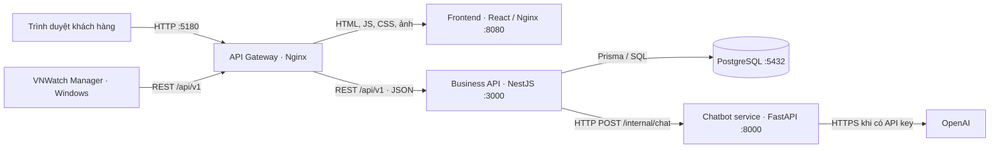

# Thiết kế Web Services của VNWatch

Bản triển khai ngày 18/11/2026 sử dụng REST API qua HTTP và JSON. Website React và ứng dụng Windows là các client. API Gateway nhận request tại cổng 5180 rồi chuyển đến dịch vụ phù hợp. Đặc tả API được sinh từ controller/DTO NestJS và model Pydantic của FastAPI.

## Sơ đồ triển khai



File chỉnh sửa sơ đồ [VNWatch-Web-Services.drawio](VNWatch-Web-Services.drawio).

| Thành phần triển khai | Trách nhiệm | Giao diện giao tiếp |
| --- | --- | --- |
| `gateway` | Điểm vào chung, định tuyến URL và thời gian chờ upstream | Host `http://localhost:5180`, container `8080` |
| `frontend` | Phục vụ React, ảnh và các trang `/products/:id` | HTTP nội bộ `http://frontend:8080` |
| `backend` | Danh mục, xác thực, tài khoản, giỏ hàng, đơn hàng, quản trị, lưu hội thoại | REST `http://backend:3000/api/v1` |
| `agent` | Phân tích nhu cầu và tư vấn bằng dữ liệu catalog do backend cung cấp | HTTP nội bộ `http://agent:8000/internal/chat`, header `X-Agent-Token` |
| `db` | Lưu dữ liệu bán hàng và `HoiThoai`/`TinNhan` | PostgreSQL trong mạng Docker |
| `init` | Áp dụng migration và nhập dữ liệu còn thiếu trước khi chạy backend | Job Docker kết thúc sau khi hoàn thành |

Các module nghiệp vụ nằm trong một tiến trình NestJS. Giỏ hàng, đặt hàng, giá và tồn kho dùng các giao dịch PostgreSQL hiện có. FastAPI là tiến trình độc lập, nhận dữ liệu catalog qua hợp đồng HTTP, không giữ kết nối database bán hàng. Cách tổ chức này dùng mô hình client–server và Web Services, với backend nghiệp vụ được chia module.

## Nhóm API nghiệp vụ

Các đường dẫn sau đặt sau tiền tố `/api/v1`.

| Nhóm nghiệp vụ | API tiêu biểu | Xác thực |
| --- | --- | --- |
| Danh mục | `GET /products`, `GET /products/facets`, `GET /products/:id` | Công khai |
| Xác thực | `POST /auth/register`, `POST /auth/login`, `POST /auth/logout` | Theo từng thao tác |
| Giỏ hàng | `GET /shop/cart`, `PUT /shop/cart` | Bearer session của khách hàng |
| Đơn hàng | `POST /orders/quote`, `POST /orders`, `GET /orders`, `GET /orders/:id` | Phiên đăng nhập và quyền sở hữu |
| Hội thoại | `GET/POST /assistant/conversations`, `GET /assistant/conversations/:id/messages`, `POST /assistant/chat` | Phiên đăng nhập hoặc cookie khách, kiểm tra chủ hội thoại |
| Quản trị | `/users`, `/management/...`, `/orders/manage` | Vai trò ADMIN theo từng route |
| Danh mục API | `GET /` | Công khai, trả links tài nguyên |
| Tình trạng | `GET /health/live`, `GET /health/ready` | Công khai |

Đường dẫn chính xác, DTO và mã HTTP được mô tả tại [Swagger](http://localhost:5180/docs). Đặc tả JSON tại [OpenAPI](http://localhost:5180/docs-json). Danh mục Web Services tại [API v1](http://localhost:5180/api/v1).

FastAPI cung cấp `GET /internal/openapi.json` trong mạng Docker. Endpoint này và `POST /internal/chat` đều yêu cầu `X-Agent-Token`. Gateway chặn đường `/internal`; trình duyệt gọi chatbot qua NestJS. Hai bản OpenAPI xuất từ hệ thống được lưu tại `outputs/vnwatch-backend/docs/openapi.json` và `outputs/vnwatch-agent/openapi.json` để đối chiếu khi học hoặc tích hợp.

## Luồng mua hàng

1. React gửi `GET /api/v1/products` đến gateway để lấy danh mục. Nhấn sản phẩm mở trang `/products/:id`, trang này đọc chi tiết qua API.
2. Khách đăng nhập bằng `POST /api/v1/auth/login`. Frontend giữ session token trong bộ nhớ và gửi header `Authorization: Bearer ...` khi gọi chức năng cá nhân.
3. Thêm giỏ qua `PUT /api/v1/shop/cart`. Backend xác thực phiên và kiểm tra SKU.
4. Checkout lấy báo giá rồi gửi `POST /api/v1/orders` với `Idempotency-Key`. Backend kiểm tra lại giá/tồn, ghi đơn và cập nhật tồn trong giao dịch database.
5. Phản hồi API được React hiển thị cho khách. Client Windows sử dụng cùng các Web Services nghiệp vụ với quyền quản trị phù hợp.

## Luồng chatbot

1. React gửi câu hỏi, `conversationId` và `requestId` đến `/api/v1/assistant/chat` qua gateway.
2. NestJS kiểm tra chủ hội thoại, lưu câu hỏi và trạng thái trả lời vào PostgreSQL, lấy lịch sử giới hạn và catalog hiện hành.
3. NestJS gọi FastAPI bằng HTTP/JSON và service token. FastAPI tư vấn theo catalog hoặc dùng OpenAI để phân tích bộ lọc khi đã cấu hình API key.
4. NestJS đối chiếu ID sản phẩm/nguồn trả về, lưu `TinNhan` của assistant và trả JSON cho React. Trạng thái lỗi được ghi lại để khách gửi lại cùng mã lượt.

Các request có giới hạn thời gian chờ. Lỗi agent trả 503 qua API chatbot; lỗi API có `code`, `message` và `requestId`. Hệ thống kiểm tra vai trò và quyền sở hữu tại backend. Gateway chuyển nguyên phương thức HTTP, query, body, cookie và header xác thực; gateway không tự thử lại request upstream. Các giao dịch COD/QR đang dùng chế độ giả lập của dự án.

## Chạy và kiểm tra

```powershell
cd D:\VNWatch
docker compose --env-file .env.docker up -d --build --wait --wait-timeout 180
docker compose --env-file .env.docker ps
Invoke-RestMethod http://localhost:5180/api/v1
Invoke-RestMethod http://localhost:5180/api/v1/health/ready
```

Cổng host 5180 thuộc gateway. Frontend, backend, agent và database giao tiếp qua tên service trong mạng Docker. Các service chính có healthcheck riêng. Dịch vụ `init` chạy migration và seed dữ liệu sản phẩm thật. Có thể cập nhật riêng giao diện bằng `docker compose --env-file .env.docker build frontend` và `docker compose --env-file .env.docker up -d --no-deps frontend`.

Để chạy riêng trên Windows khi phát triển, giữ script `START-VNWATCH.cmd`: Vite phục vụ React ở 5173, NestJS ở 3000, FastAPI ở 8000; Vite proxy `/api` tới NestJS. App quản trị đang dùng URL API 5180 tiếp tục đi qua gateway trong chế độ Docker.

Mã nguồn cần đọc gồm `compose.yaml`, `docker/gateway.conf`, `outputs/vnwatch-frontend/nginx.conf`, `outputs/vnwatch-frontend/src/api.ts`, `outputs/vnwatch-backend/src/api-index.controller.ts`, `outputs/vnwatch-backend/src/openapi.ts` và `outputs/vnwatch-agent/main.py`.

Tài liệu tham khảo chính thức về [OpenAPI trong NestJS](https://docs.nestjs.com/openapi/introduction) và [giao tiếp giữa các service Docker Compose](https://docs.docker.com/compose/how-tos/networking/).
