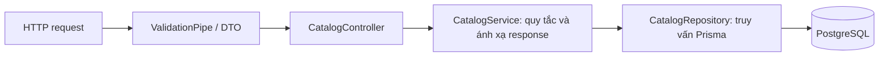
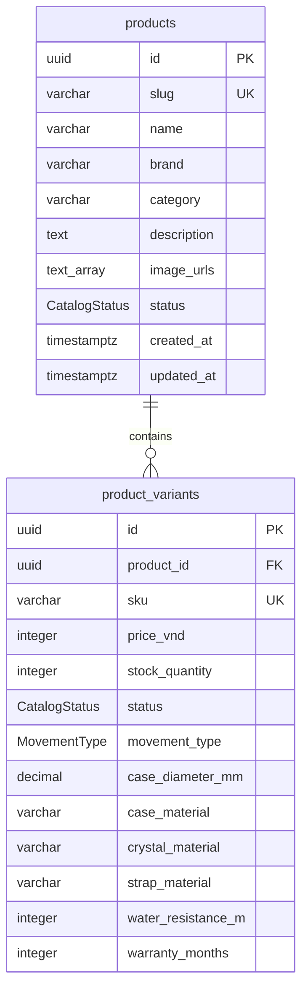

# Thiết kế phần 01

## Mở rộng Shopping/Management — 03/10/2026

`ShopModule` dùng DatabaseModule và CatalogModule. Controller tách `/shop` (owner) và `/management` (ADMIN), DTO whitelisting/validation, SessionGuard/RolesGuard và service kiểm tra lại user/session/role sau khóa trong transaction. CartLine, Favorite, SavedAddress, SupportTicket/TicketMessage và ProductReview thuộc tài khoản; public review không lộ email/ID người mua. BusinessAudit lưu actor/lý do/trước/sau. Product/SKU sửa dùng expectedUpdatedAt và expectedStockQuantity để từ chối bản cũ.

Promotion/PromotionUse và snapshot discountVnd/promotionCode của Order được thêm qua migration `20261003000000_shopping_management`. Checkout khóa user, SKU và promotion, kiểm tra hạn/lượt mã, lưu đơn/lượt và trừ giỏ trong cùng transaction. Retry trả đơn cũ; cancellation không hoàn lượt mã. CHECK tiền đơn là subtotal - discount + shipping, từng số nguyên VND không vượt Int PostgreSQL.

Bảo hành được suy ra từ OrderItem snapshot và sự kiện COMPLETE của đơn COMPLETED/PAID/DELIVERED, chưa tạo serial. Review cần chính tài khoản mua hoàn tất. Support liên quan đơn/bảo hành kiểm tra owner và trạng thái, reply đóng yêu cầu dùng optimistic concurrency. Báo cáo RepeatableRead chỉ cộng đơn hoàn tất đã thu COD.

React không còn lưu giỏ dùng chung trong localStorage, ghi qua `/shop/cart`. Token giữ memory; session revision bỏ phản hồi cũ khi đổi tài khoản. API private dùng Cache-Control no-store. Phạm vi hiện hành đầy đủ ở [COMPLETENESS.vi.md](COMPLETENESS.vi.md); ERD catalog bên dưới là thiết kế ban đầu.

## Luồng xử lý

Controller hiểu HTTP. Service kiểm tra khoảng giá và định nghĩa response công khai. Repository chứa điều kiện hiển thị, tìm kiếm, phân trang. `PrismaService` quản lý một connection pool và vòng đời kết nối. Không có generic repository hoặc interface chỉ để bọc một implementation.

## ERD đã triển khai

Biến thể có giá, tồn và thông số riêng vì dây, kích thước hoặc bộ máy có thể thay đổi theo SKU. Mẫu gom tên, mô tả, thương hiệu, danh mục và ảnh. `brand`, `category` tạm là chuỗi; chưa có CRUD quản lý hai thực thể này để cần thêm bảng. Không tạo bảng serial hoặc phiếu bảo hành trước nghiệp vụ tương ứng.

## ADR-001: modular monolith và phạm vi nhỏ

**Lựa chọn:** một ứng dụng NestJS, một PostgreSQL. Chỉ tạo Catalog, Database và Health đang có chức năng. **Thay thế:** tạo trước tất cả module hoặc tách dịch vụ. **Đánh đổi:** chưa có triển khai độc lập từng module; đổi lại chạy local đơn giản, transaction liên module về sau rõ ràng. Redis, hàng đợi và search engine chưa giải quyết vấn đề cụ thể của phần này.

## ADR-002: kiểu dữ liệu và tính toàn vẹn

Giá dùng PostgreSQL INTEGER, đơn vị VND, miền 0..2.147.483.647. API và database cùng giới hạn. Khi thiết kế tổng đơn hoặc hỗ trợ giá cao hơn, đánh giá BIGINT/DECIMAL và quy tắc serialize; không ép BIGINT sang JavaScript Number thiếu kiểm tra. Số đo đường kính là DECIMAL(5,2), API trả chuỗi chính xác hai chữ số thập phân. Không dùng kiểu này để tính tiền.

Ngày giờ dùng TIMESTAMPTZ; Node xuất UTC ISO 8601, ví dụ hậu tố Z. Frontend về sau định dạng bằng `Asia/Ho_Chi_Minh`. SKU và slug có unique index; khóa ngoại RESTRICT chặn xóa mẫu còn SKU. Giá/tồn, bảo hành/chịu nước không âm và đường kính dương được bảo vệ bằng CHECK trong SQL migration. Những constraint này không thay thế transaction checkout tương lai.

## ADR-003: đọc catalog và tìm kiếm

Chỉ trả mẫu ACTIVE có ít nhất một SKU ACTIVE. SKU hết tồn vẫn hiển thị để khách biết sản phẩm; `inStock` chỉ là thông tin tại lúc đọc. SKU ngừng bán và mẫu DRAFT/DISCONTINUED bị ẩn ở cả danh sách và chi tiết. Đây là chính sách đề xuất cho API công khai, không khẳng định báo cáo gốc đã quy định như vậy.

Khoảng giá áp dụng trên cùng một SKU bằng `gte` và `lte`; danh sách chỉ trả các SKU thỏa khoảng đó. Chi tiết trả toàn bộ SKU ACTIVE. Ngừng bán giữ bản ghi. Chưa có Orders nên chưa thể tuyên bố lịch sử mua hàng đã được bảo vệ bằng snapshot.

Tìm kiếm ILIKE theo tên hoặc thương hiệu, không phân biệt hoa thường; escape `%`, `_`, `\` để chúng là ký tự tìm kiếm thông thường. Chưa hỗ trợ bỏ dấu tiếng Việt, sửa lỗi chính tả hoặc tìm bằng ảnh. Trang tối đa 1000, mỗi trang tối đa 50, trường sort dùng allowlist và thêm ID để thứ tự ổn định khi bằng nhau.

Count và dữ liệu trang chạy trong transaction REPEATABLE READ để cùng snapshot. Không có cuộc gọi mạng trong transaction. Phương án đơn giản hơn là hai câu đọc READ COMMITTED; đánh đổi là metadata và danh sách có thể lệch khi dữ liệu đổi giữa hai câu. Phân trang offset vẫn có thể dịch giữa hai HTTP request; cursor pagination được xem xét nếu dữ liệu/tải thực tế cần.

Index `(status, created_at, id)` hỗ trợ lọc trạng thái và thứ tự mặc định; `(product_id, status, price_vnd)` hỗ trợ tra SKU theo mẫu. Không tuyên bố index này tăng tốc ILIKE `%keyword%` hoặc đã đủ tối ưu; cần EXPLAIN và benchmark trước khi đổi. Tên và category chưa có index chuyên dụng vì tập dữ liệu nhỏ, chưa có phép đo.

## ADR-004: hạ tầng phát triển và an toàn dữ liệu test

Prisma 7 dùng generator `prisma-client` với output riêng và driver adapter `@prisma/adapter-pg`. CommonJS được khai báo tường minh để thống nhất Nest, TypeScript và generated client. Package lock cố định bản đã cài.

Integration test sử dụng PostgreSQL thật, schema ngẫu nhiên riêng trong DB test và migration thực thi được. Không có mock transaction. Test schema được truyền cho cả Prisma adapter và Prisma CLI; chỉ URL CLI là chưa đủ để adapter chọn schema. Helper Windows chỉ phục vụ local, có tài khoản sở hữu cluster; đây không phải mô hình quyền DB production.

## Tài liệu đã đối chiếu

- [NestJS: tích hợp Prisma](https://docs.nestjs.com/recipes/prisma)
- [NestJS: validation](https://docs.nestjs.com/techniques/validation)
- [NestJS: OpenAPI](https://docs.nestjs.com/openapi/introduction)
- [PostgreSQL: transaction isolation](https://www.postgresql.org/docs/current/transaction-iso.html)

Các quyết định phía trên thuộc dự án, không phải bảo đảm hiệu năng/bảo mật từ tài liệu nhà cung cấp.
